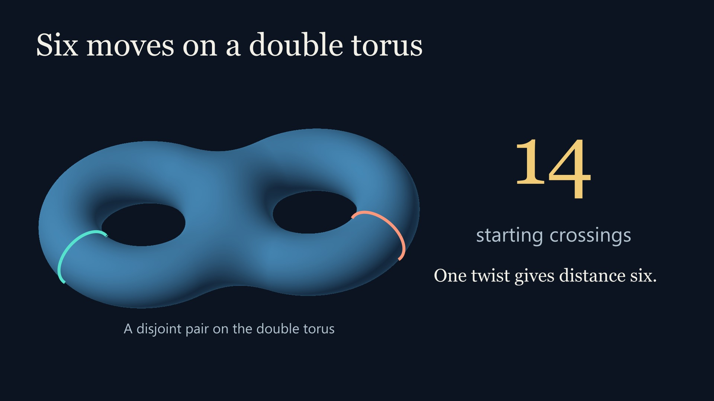

# How many crossings does distance six require?

**On the closed double torus, the minimum is 132 crossings at distance six and 40 crossings at distance five.** An explicit pair attains each value. A computer-assisted proof covers all smaller diagrams, including pairs with separating endpoints. Jin and Menasco's general intersection inequality had supplied lower bounds of 48 and 24, respectively. Two implementations check the global exclusion. Python and Lean reconstruct the extremal diagrams. The paper states the topological arguments and the scope of the formalization. [Minimum-intersection paper](paper/minimum-six.pdf) · [LaTeX](paper/minimum-six.tex) · [Reproduce the census](computations/minimum/) · [Prior intersection bounds](paper/minimum-six-literature.md)

**What changes if one curve must be a twist of the other?** Start with curves $a,b$ four moves apart. Twist $a$ once about $b$, then measure the distance from $a$ to its image. The least starting intersection number giving distance six is **14**, producing **196** endpoint crossings. Mahanta had proved that her 12-crossing example reaches distance five in one turn. The sharp small-twist results and their relation to her conjectures appear in our first paper. [Short-twist paper](paper/short-twists.pdf) · [LaTeX](paper/short-twists.tex) · [Literature and priority](paper/literature-and-priority.md)

[Watch the narrated film](video/six-moves.mp4) · [English captions](video/captions.vtt) · [Animation and narration source](video/)

## What Mahanta established

A vertex represents an essential simple closed curve, up to isotopy. An edge means that two distinct curves can be drawn disjointly. Distance is the fewest edges in any path. Drawing six edges gives an upper bound. A shortcut anywhere in this infinitely branching graph could still lower the answer.

Existence at every distance follows from infinite diameter. Masur and Schleimer trace the early argument to Kobayashi's 1988 Proposition 2.2. Direct geometric constructions include Schleimer's 2006 preprint and Ido, Jang and Kobayashi's Construction 4.6, where one can set $n=6$. Aougab and Taylor's Lemma 5.1 also produces length six by folding a geodesic with a large twist power. [Historical attribution](https://sschleimer.warwick.ac.uk/Maths/2012geom_disk_complex.pdf#page=5) · [Schleimer, Proposition 3.1](https://arxiv.org/pdf/math/0608505#page=4) · [Ido–Jang–Kobayashi, p. 1403](https://msp.org/agt/2014/14-3/agt-v14-n3-p06-p.pdf#page=9) · [Aougab–Taylor, §5](https://arxiv.org/pdf/1310.4711#page=11)

Mahanta and Palaparthi proved that **every distance-three pair** gives distance four after one Dehn twist. Starting instead at distance four, Mahanta showed that one twist gives a distance between four and six. Her Lemma 9 characterizes four-edge shortcuts by a geometric condition called stacking. Theorem 2 simplifies the test when the starting curves leave no hexagonal regions. [Mahanta–Palaparthi, Theorem 2](https://doi.org/10.1016/j.topol.2022.108137) · [Mahanta, Lemma 9 and Theorem 2](https://arxiv.org/pdf/2211.15290v3#page=19)

Her actual genus-two example has hexagons. She exhibited a five-edge route and excluded every four-edge shortcut for the 12-crossing pair in Figure 18. One twist therefore gives distance exactly five with 144 endpoint crossings. The starting diagram comes from Birman, Margalit and Menasco. The MICC paper established the 12-crossing minimum at distance four and tabulated starting weights at 12, 13 and 14 crossings. [First preprint, November 2022, §4](https://arxiv.org/pdf/2211.15290v1#page=15) · [Figure 18 in version 3](https://arxiv.org/pdf/2211.15290v3#page=20) · [MICC, §6](https://arxiv.org/pdf/1408.4134#page=18)

## What this paper extends

Write $D_k=d(a,T_b^k a)$ for the distance after $k$ twists about $b$.

| Starting curves on the double torus | Exact outcome |
|---|---|
| Mahanta's marked Figure 18 | $D_0=0$, $D_{1}=D_{-1}=5$, and $D_k=6$ for every $\lvert k\rvert\ge2$. |
| Every distance-four starting pair with 12 crossings | All 5 ordered classes give $D_1=5$. |
| Every distance-four starting pair with 13 crossings | All 11 ordered classes give $D_1=5$. |
| A specified distance-four starting pair with 14 crossings | $D_1=6$. Its signed word is printed below. |

The 12- and 13-crossing counts identify ordered pairs up to homeomorphisms of either orientation. Together the rows settle two different conjecture wordings. Minimum intersection **suffices** in genus two, as proposed in March 2023 and in Mahanta's thesis. The 13-crossing pairs disprove the **necessity** proposed in the August 2023 preprint. For Figure 18 the complete power calculation also answers Question 1 of that preprint for its named example. A classification for every distance-four pair and every small power remains open in this work. [March version, p. 2](https://arxiv.org/pdf/2211.15290v2#page=2) · [August version, p. 2](https://arxiv.org/pdf/2211.15290v3#page=2) · [Thesis, Question 4](https://gyan.iitg.ac.in/server/api/core/bitstreams/5ff9c20a-8ec9-40de-b253-4c1d153e1534/content#page=19)

There are two ways to interpret “extend five to six.” In Figure 18 a second turn **about the original axis** takes the distance from five to six. Starting afresh with two curves already five apart and twisting one about the other poses a different question. The results here concern the original axis and distance-four inputs.

Here is the 14-crossing example. Number the intersections in order on $a$. Read their signed labels in order along $b$, using the side convention in §2 to recover the ribbon surface.

~~~text
(1, -9, -3, -11, -5, -6, -7, -8, -2, -10, -4, 12, 13, 14)
~~~

Higher twist powers produce at least $2\cdot12^2=288$ intersections for these distance-four inputs. One unrestricted extremal pair has six bands of widths $(30,30,6,6,30,30)$ and gluing shift 13. Its 132 crossings bound 126 squares and four hexagons. A second minimizer has widths $(29,30,7,7,30,29)$ and the same shift. Their absolute algebraic intersections are 96 and 48, so they represent different homeomorphism orbits. [Gluing diagram and coordinates](paper/minimum-six.pdf#page=4) · [Signed crossing words](computations/minimum/witnesses.json)

## Reproduce the checks

Run the following from the repository root with Python 3.9 or newer. The geometry and census scripts use the standard library.

~~~sh
python computations/verify_distance_six.py --audit
python computations/census_small_seeds.py 12 13
python computations/generate_seeds.py
python computations/certificates.py
python computations/verify_distance_six.py --distance 7
python computations/minimum/verify_witnesses.py --uniform-bound
~~~

The first command checks the marked twist examples. The second enumerates the small starting intersection counts. The command with argument 7 prints twist words for any requested nonnegative distance. The final command reconstructs the 40- and 132-crossing examples and checks their exact distances with two choices of search bound. Instructions for reproducing the global minimum use a C++17 compiler and the released per-size counts. [Twist verification transcripts](computations/audit/) · [Unrestricted census](computations/minimum/)

The Lean package pins Lean **4.8.0** and mathlib **v4.8.0**. From the repository root, run

~~~sh
lake exe cache get
lake build
~~~

Lean constructs the two marked essential embedded circles on a compact quotient of the real cylinder. It proves that the second represents the once-twisted first curve and that the specified representatives meet in exactly **196 points**. Lean also independently regenerates the 12- and 13-crossing census. The distance-six declaration takes explicit hypotheses about how the search represents curves and captures all short paths. The formal identification of the quotient with the double torus and the proof of those hypotheses remain open. [Formal results and open obligations](proof/README.md) · [Named examples](proof/SurfaceExamples.lean) · [Library and source audit](proof/library-audit.md)

## Inside the film

The opening illustrates a legal disjoint move on a two-handled surface. Read the signed crossing order of the starting pair, then watch its strands wrap through a cut-open collar. A four-edge path folds into a six-edge route. An annular distance ruler explains the large-power proof. After the 14-crossing twist example and a construction at distance seven, the final chapter shows the six bands, gluing shift, and exclusion of all crossing counts below 132.

The video uses Manim Community for animation and the Kokoro-82M model with the stock English voice **af_heart** for narration. Spoken phrases set the animation and caption times. The selected subtitles are also available separately. [Film source and rendering instructions](video/) · [Manim Community](https://www.manim.community/) · [Kokoro model card](https://huggingface.co/hexgrad/Kokoro-82M) · [Kokoro ONNX](https://github.com/thewh1teagle/kokoro-onnx)
